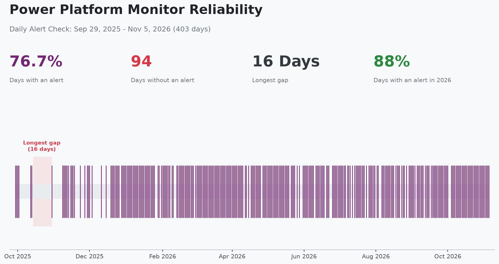
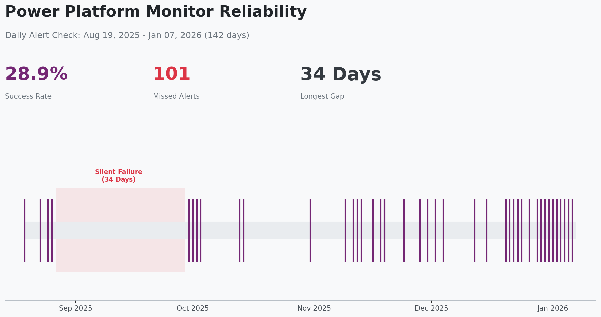

# Power Platform Monitor Coin Flip (Power Automate)

A tiny, connector-free cloud flow that fails ~50% of runs to test **Power Platform Monitor** dashboards and **Monitor Alerts** in PPAC.

## Quick start (2 minutes)
1. Download `CoinFlip_unmanaged.zip` from this repo.
2. In a suitable Power Platform environment, go to **Solutions** → **Import** → pick the zip → **Publish all customizations**.
3. Open flow **Coin Flip – PPAC Monitor test** → **Turn on** (adjust schedule if you want, default is every 3h).
4. In **PPAC → Monitor → Create alert**  
   - Product: **Power Automate**  
   - Product type: **Cloud flow**  
   - Metric: **Success rate**  
   - Operator: **Is Under**  
   - Value: **98** (or lower if you want excitement)

**Expected**: The flow fails ~50% of runs. Monitor charts/alerts are daily-aggregated and can be late or flaky—this flow helps you observe that behavior.

## Change failure rate
Edit the Condition expression threshold (last hex digit of `guid()`):
- 50% (default): even parity check
- 75%: `less(indexOf('0123456789abcdef', substring(toLower(guid()),35,1)), 12)`
- 25%: same but threshold `4`

## But why?
Because the Power Platform Monitor features that Microsoft has rolled out in 2025 don't seem to be reliable enough to "just work". In fact, some of them are less reliable than a coin flip that would give you 50% chances of being right.

Read my article [Who monitors the Power Platform Monitor](https://www.perspectives.plus/p/who-monitors-the-power-platform-monitor) for more details. I've also been sharing updates about [missing telemetry data](https://www.linkedin.com/feed/update/urn:li:activity:7374337699186544640/) and [lack of alerts](https://www.linkedin.com/feed/update/urn:li:activity:7381217782463537152/) on LinkedIn.

## Latest Results: 403 Days of Testing

**Key findings from Sep 29, 2025 - Nov 5, 2026:**
- **76.7% of days had an alert** - 309 out of 403 expected daily alerts were received
- **94 days without an alert** - in 43 separate gaps
- **Clearly better in 2026** - 39% of days had an alert in Sep-Dec 2025, 88% from Jan 1 to Nov 5, 2026
- **Longest gap: 16 days** - Oct 14-29, 2025, zero notifications

How this is counted:
- The flow fails roughly every second run and runs 8 times a day, so a day without a single failure is very unlikely (about 0.4%). Every day should therefore produce an alert.
- A day counts as covered when an alert email names it in the body `Timestamp`. Most days actually get two emails; the reason is unknown.
- Sep 29, 2025 is the start of the valid test: it is when the current flow was created. Results before that are kept below for history, but not counted.
- Power Automate deletes old flow runs, so only recent run history can be checked. For Oct 12 - Nov 5, 2026 it was still available, and in that period the flow failed on every single day and an alert arrived for every one of them. Earlier missed days can't be checked against the runs.

Monitor Alerts have improved, but over the whole period roughly 1 day in 4 had no alert, and in 2026 still about 1 in 8. That is not what you'd want from a monitoring tool you rely on without a second line of defence.

The alert emails were exported from the mailbox with Microsoft Graph into a spreadsheet; the days are in `alert_days.csv`.

Earlier test results (142 days, Aug 19, 2025 - Jan 7, 2026)

**Key findings as originally published:**
- **28.9% success rate** - Only 41 out of 142 expected daily alerts were received
- **101 missed alerts** - Over 70% of alerts never arrived
- **34-day silent failure** - Complete outage from Aug 27 to Sep 29, 2025 with zero notifications

Note added Nov 2026: the Aug 19 - Sep 28, 2025 part predates the current flow (created Sep 29, 2025) and is not counted in the results above, so the 34-day gap and these percentages should not be read as a measurement of the current flow. The chart was drawn by `generate_reliability_chart_142_days.py`.

Earlier test results (40 days)

---

**Made by Jukka Niiranen / Niiranen Advisory Oy.**  
If these kind of things are interesting to you:
- Subscribe to my newsletter **Perspectives on Power Platform** → [perspectives.plus](https://www.perspectives.plus/)
- Hire me for your **Power Platform advisory** needs → [niiranenadvisory.com](https://niiranenadvisory.com/)
